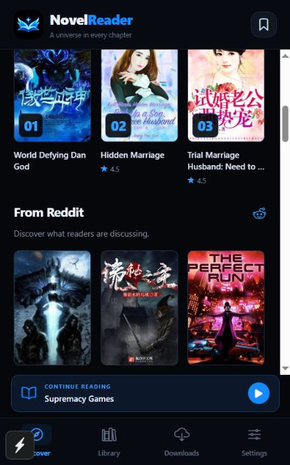

# NovelReader

Expo SDK 58 light novel reader with a black/neon-blue interface, magical-book branding, offline downloads, customizable reading preferences, and a TypeScript scraping backend.



## Start

Requires Node.js 24+ and npm. From the repository root:

```sh
npm ci
npm run dev
```

The API runs on port **4000** and Expo prints a QR code. For a physical phone, copy `apps/mobile/.env.example` to `apps/mobile/.env`, set `EXPO_PUBLIC_API_URL` to your computer's LAN address, and restart Expo. Android emulator defaults to `http://10.0.2.2:4000`; web/iOS simulator default to `http://localhost:4000`.

```sh
npm run api
npm run mobile
npm run web -w @novelreader/mobile
npm run check
```

Three original sample stories are included. Live catalogue records are stored in your local API database and are intentionally excluded from Git. Discovery groups matching titles across sources into one entry, prioritizing a cached copy when available. The saved library also deduplicates matching titles while preserving existing reading progress/downloads.

## Reading and importing

1. **Catalogue:** crawl source listing pages for novel names, covers, genres, and available metadata. Chapter bodies are not fetched during this crawl.
2. **Open a novel:** import its chapter index—chapter numbers, titles, and source URLs. This is the default `index` mode. No chapter bodies are fetched.
3. **Select a chapter:** the app requests a persistent single-chapter job, waits for it to finish, and displays the text. The backend caches the body for subsequent reads.
4. **Download:** selected chapters are fetched as needed and saved to the phone's SQLite database (IndexedDB in the web preview). Downloads can be paused and resumed without downloading saved chapters again.

An explicit `all` import mode is also available through the API for fetching all available chapter bodies in the background. It is never the default when a novel is opened.

Reader settings include font size, serif/sans fonts, line spacing, alignment, night/paper/sepia themes, background and text colours, bookmarks, and saved reading position. Open **Aa** inside a chapter to change preferences.

Discovery includes a **Top 10** shelf, Reddit discussion picks, genre filters, and search. Reader ratings support 1–5 stars, one updatable vote per device identity, and aggregate across duplicate source entries. Imported community scores remain separate from reader votes. The UI does not display scraper names, source URLs, or backend administration controls.

Reddit picks use **public RSS and verified discussion links**, with no Reddit Data API key or OAuth flow. Live RSS refresh is optional, paced, cached, and falls back to curated links when feeds are unavailable. Reddit mentions are discussion signals, never fabricated star ratings or upvote counts. See [community features](docs/community.md).

## Scraping sources

| Source ID          | Default  | Implementation / live verification                                                                             |
| ------------------ | -------- | -------------------------------------------------------------------------------------------------------------- |
| `freewebnovel-net` | Enabled  | FreeWebNovel.net; catalogue titles/covers, paginated chapter index, chapter text verified live                 |
| `readnovelfull`    | Enabled  | ReadNovelFull; catalogue titles/covers, public complete archive endpoint, on-demand chapter text verified live |
| `freewebnovel`     | Disabled | FreeWebNovel.com; returns Cloudflare challenge pages in this environment                                       |
| `empirenovel`      | Disabled | EmpireNovel; returns Cloudflare challenge pages; adapter remains provisional                                   |

**FreeWebNovel.net and FreeWebNovel.com are separate sources.** They are not silently substituted for one another.

Copy `apps/api/.env.example` to `apps/api/.env` to change enabled sources, request pacing, database path, or access token. Use sources and content you have permission to import and store. The transport checks robots.txt, restricts scrape requests and redirects to registered hosts, applies a per-source delay, limits response size, times out stalled requests, and retries transient failures. It identifies browser challenges and reports them without attempting to solve them.

The first backend launch automatically indexes enabled sources when their catalogues are empty. Set `AUTO_INDEX_CATALOG=false` to disable this. Start refreshes and inspect crawls with the CLI while the API is running:

```sh
npm run scrape -w @novelreader/api -- probe freewebnovel-net
npm run scrape -w @novelreader/api -- catalog freewebnovel-net
npm run scrape -w @novelreader/api -- catalog readnovelfull
npm run scrape -w @novelreader/api -- import https://freewebnovel.net/renegade-immortal.html
npm run scrape -w @novelreader/api -- status
npm run scrape -w @novelreader/api -- status JOB_ID
npm run scrape -w @novelreader/api -- failures JOB_ID
```

Catalogue crawls checkpoint every page, resume after restart/failure, deduplicate novels by canonical source URL, and detect repeated pages. Each enabled source can crawl independently. The crawler indexes every page exposed by its configured listing route; a source may have unlisted works or change its catalogue. Cover URLs are stored with the novel; source cover images are loaded remotely, not cached offline.

See [backend details](docs/backend.md) for the on-demand workflow, HTTP examples, failure handling, and source-specific behavior. See [design notes](docs/design.md) for the visual direction.

## Project

```text
apps/mobile/       Expo Router app, reader, preferences, offline chapter databases
apps/api/          Express API, SQLite, source registry/parsers/transport, workers, tests
packages/shared/   Shared TypeScript API contracts
scripts/           Branding asset preparation
.github/workflows/ CI: types, lint, backend integration tests, web export
```

## Deploy the API

```sh
docker compose up --build -d
```

SQLite persists in a Docker volume. Run **one API replica** with these embedded workers. Back up with SQLite's backup facilities or stop the server before copying its database files.

For a public deployment, configure `API_TOKEN`, HTTPS, and `CORS_ORIGINS`. Set the corresponding API URL and `EXPO_PUBLIC_API_TOKEN` for the app. Expo public variables ship inside the app: this shared token is for a personal/trusted-client deployment. It is not a substitute for per-user authentication. This version has a shared backend catalogue and device-local libraries/progress; multi-user accounts, cloud progress sync, and distributed workers are not included.

## Mobile builds

`apps/mobile/eas.json` includes development, preview APK, and production profiles. Replace the application identifiers before a store release.

```sh
cd apps/mobile
npx eas-cli@latest login
npx eas-cli@latest build:configure
npx eas-cli@latest build --platform android --profile preview
```

EAS needs your Expo account and project linking. Signing and store submission have not been performed. Expo Go can run the bundled native modules used here when its SDK version matches the project. For wireless Android testing, pair with ADB, reverse ports 4000 and 8081, and use `EXPO_PUBLIC_API_URL=http://127.0.0.1:4000` on that device. `scripts/android-smoke.mjs DEVICE_SERIAL` captures Expo-only diagnostics when Expo Go is in the foreground.
